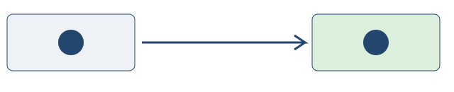

# Read before writing

A chapter starts with a reader and a concrete question. Define the idea, explain
why it matters, then show how it works. ⟦decided⟧

## Follow a visible path

Move from a rough note to a reviewed explanation. Keep a diagram beside the
paragraph it supports, and keep its editable source beside the render.

Use `book.json` to choose the language and table of contents. Use a public
specification and version as the authority for exact formats.

> A proposal is a proposal until an explicit decision changes its status.
